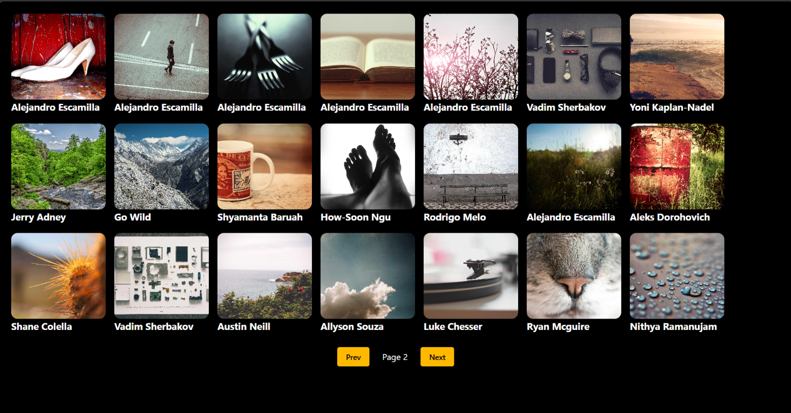

# 🖼️ React Image Gallery

A simple and interactive image gallery built with **React, Tailwind CSS, and the Picsum Photos API**. The application fetches images dynamically and displays them in a clean card-based layout with pagination controls.

## 📸 Screenshot

o Screenshot :



## ✨ Features

- 🖼️ **Dynamic Image Gallery** – Fetches images from the Picsum Photos API.
- 📄 **Pagination** – Navigate between image pages using Previous and Next buttons.
- ⚡ **API Integration** – Fetches image data using Axios.
- ⏳ **Loading State** – Displays a loading message while images are being fetched.
- 🎨 **Modern UI** – Styled with Tailwind CSS.
- 🧩 **Reusable Components** – Displays images using a separate Card component.
- 🔗 **Image Links** – Open the original image page in a new tab.

## 🛠️ Tech Stack

- React.js
- JavaScript (ES6+)
- Tailwind CSS v4
- Axios
- Vite
- Picsum Photos API


## 🌐 API Used

This project uses the [Picsum Photos API](https://picsum.photos/) to retrieve image data.

**API endpoint:**

```text
https://picsum.photos/v2/list?page=1&limit=21
```

- `page` – Selects the image page.
- `limit` – Specifies the number of images requested per page.

## 📂 Project Structure

```text
react-image-gallery/
├── public/
|    └── Screenshot.png
├── src/
│   ├── components/
│   │   └── Card.jsx
│   ├── App.jsx
│   ├── App.css
│   ├── index.css
│   └── main.jsx
├── index.html
├── package.json
├── vite.config.js
└── README.md
```

## 📚 What I Learned

- Fetching API data using Axios.
- Managing state with React's `useState` hook.
- Using `useEffect` to fetch data when the page changes.
- Creating reusable React components and passing props.
- Rendering lists of images using `map()`.
- Implementing pagination with state updates.
- Styling components using Tailwind CSS.

## 👨‍💻 Author

**Manoj Anand Madke**

- GitHub: [@ManojMadke](https://github.com/ManojMadke)

---

⭐ If you like this project, consider giving the repository a star!
